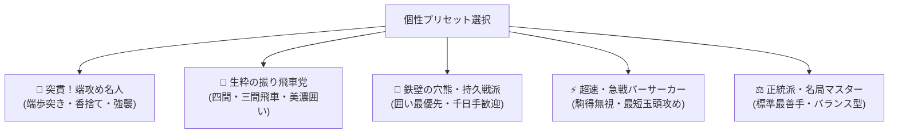

# 棋樹 (joseki-tree) - AIエンジン個性カスタマイズ仕様書 (AI Engine Personality & Parameter Tuning Spec)

本書は、将棋AI（Wasm Web Worker上の Fairy-Stockfish / やねうら王系エンジン）に対し、USIパラメータや評価関数重み、探索バイアスを変数化・プリセット化することで、「端攻め好き」「振り飛車党」「超攻撃型」「持久戦・穴熊派」など、**プレイヤーの学習目的に合わせた多様な棋風・個性を持つスパーリング相手を生成・保存・選択できる機能**の正式仕様を定義する。

---

## 1. 機能概要と目的

### 1.1 背景
- 通常の将棋エンジンは「最善手・勝率最大化（居飛車志向、バランス型）」のみを追求するため、アマチュアの対人実戦で頻出する「端攻め」「奇襲」「振り飛車」「泥沼の粘り」などの対策練習がしにくい。
- エンジン側の探索制御（USIオプション）や局面評価の傾向（駒の価値、キングセーフティ、進行バイアス）を変数化することで、**「特定の戦型や棋風を相手にした仮想スパーリング」**を実現する。

### 1.2 期待される効果
- 「振り飛車相手の右四間飛車を練習したい」ときに、確実に飛車を振ってくれるAIを生成。
- 「端攻めの受け」を練習したいときに、1筋・9筋の歩を積極的に突いてくるAIと対局。
- ユーザー自身が「AIの性格パラメータ」をいじって保存・共有できるゲーミフィケーション要素。

---

## 2. 変数化パラメータ設計（チューニング軸）

完全な思考ルーチンを一から自作するのではなく、**USI標準オプション ＋ 探索バイアス ＋ 定跡ツリー連動 ＋ 評価値補正** の組み合わせによって軽量かつ決定論的に個性を演出する。

| パラメータ名 | 変数キー | 設定範囲 | 影響する挙動・棋風 |
| :--- | :--- | :--- | :--- |
| **① 攻撃的 vs 守備的** | `aggressiveness` | -100 (堅陣・持久戦) 〜 +100 (超攻撃・攻め重視) | 攻め駒の進出、相手玉への迫り方を評価値に加点/減点。低いと穴熊・銀冠などの囲いを優先。 |
| **② 筋の好み (端攻めバイアス)** | `edgeAttackPreference` | 0 (標準) 〜 +100 (端攻め偏愛) | 1筋・9筋（端）の歩突き、香・桂の活用、端の駒交換の評価を底上げする。 |
| **③ 序盤戦型志向 (居飛車 vs 振り飛車)** | `openingPreference` | `'ibisha'` / `'furibisha'` / `'free'` | 序盤（1〜30手目）で飛車を振る（2〜5筋から6〜8筋へ振る）候補手、または居飛車定跡に強制・加重ボーナス。 |
| **④ 駒得重視 vs 駒の働き重視** | `materialWeight` | 50% (手厚さ・大局観) 〜 150% (駒得至上主義) | 駒得を何より優先するか、多少の駒損（角切り、捨て駒）を許容してスピードを重視するか。 |
| **⑤ 思考深さ・ランダム度 (実力調整)** | `randomness` / `depth` | depth: 3〜15<br>multipv variance: 0〜200cp | 最善手固定ではなく、評価値の差が小さい（例: 80cp以内）の上位候補手の中からランダムに選択することで、人間らしい揺らぎを再現。 |

---

## 3. デフォルト個性プリセット一覧

ユーザーがゼロから調整しなくても、ワンクリックで選べる標準プリセットを用意する。



| プリセット名 | ID | 概要・特徴 | パラメータ構成 |
| :--- | :--- | :--- | :--- |
| **突貫！端攻め名人** | `edge_attacker` | 端の歩を早期に突き、香車や角の睨みで端破りを執拗に狙う。 | `edgeAttackPreference: 90`, `aggressiveness: +60` |
| **生粋の振り飛車党** | `furibisha_master` | 序盤は必ず飛車を振って美濃囲いに組む。捌き重視。 | `openingPreference: 'furibisha'`, `materialWeight: 70%` |
| **鉄壁の穴熊派** | `anaguma_fortress` | 自玉が安全になるまで攻めない。駒得と自玉の堅さを最優先。 | `aggressiveness: -80`, `materialWeight: 130%` |
| **急戦バーサーカー** | `berserker_attack` | 序盤から玉頭に歩を連打し、リスクを恐れず攻め潰しにかかる。 | `aggressiveness: +90`, `materialWeight: 60%` |
| **正統派・標準AI** | `balanced_standard` | エンジン本来の冷静沈着な最善手・バランス型。 | 全パラメータ 0（デフォルト） |

---

## 4. TypeScript データモデル定義

`src/types/aiPersonality.ts` として定義する設計：

```typescript
export type OpeningStyle = 'ibisha' | 'furibisha' | 'free';

export interface AIPersonalityParams {
  id: string;
  name: string;
  description: string;
  icon: string; // 絵文字 e.g. '👺', '🪭', '🏰'
  
  // チューニングパラメータ
  aggressiveness: number;        // -100 (堅陣) 〜 +100 (超攻撃)
  edgeAttackPreference: number;  // 0 (通常) 〜 100 (端攻め重視)
  openingPreference: OpeningStyle; // 居飛車 / 振り飛車 / 自由
  materialWeight: number;        // 50% 〜 150% (駒得重視度)
  
  // エンジン探索設定
  depth: number;                 // 探索深さ (4〜15)
  varianceCp: number;            // 許容評価差 (0〜150cp) - 上位手からのランダム揺らぎ
  isCustom?: boolean;            // ユーザー作成カスタム設定フラグ
}
```

---

## 5. 実装アプローチ（どうやってエンジンに反映するか）

ブラウザWasm（USIプロトコル）環境でこれを実現するための3つのアプローチ：

1. **定跡ツリー（Opening Tree）との初期連動**:
   - `openingPreference: 'furibisha'` の場合、1〜20手目は「振り飛車定跡ツリー」から手を選択。定跡を抜けた後はWasmエンジンが引き継ぐ。
2. **候補手フィルタリング（Multi-PV Filter）**:
   - エンジンに `go depth X multipv 5` で上位5手を計算させる。
   - 返ってきた候補手の中に「端の歩を突く手（1筋・9筋）」や「玉を囲う手」がある場合、`edgeAttackPreference` や `aggressiveness` に応じて評価値スコアを仮想的にボーナス加算し、最終手を選択する。
3. **USIオプションの動的注入**:
   - `Skill Level`（強さレベル）、`Contempt`（引き分け嫌悪度・勝ちへの執着度）などの標準USIオプションを個性値に合わせて動的に設定。

---

## 6. UI配置方針（1画面完結スタジオへの統合）

- 右パネルの **【AI対局】モード** の上部に、小さなドロップダウンまたはアバターアイコンを配置：
  ```
  対戦相手: [👺 端攻め名人 ▼]  [⚙️ パラメータ編集]
  ```
- 普段は邪魔にならず、ワンクリックで「端攻め対策」「振り飛車対策」に切り替えてスパーリング可能。
- 詳細編集モーダルを開けば、スライダーでパラメータを自由に弄って「オレオレAI」として保存できる。
