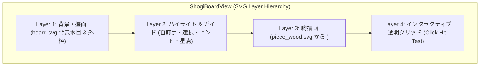

# 棋樹 (joseki-tree) - 本格木目SVG盤面・駒スプライト刷新 仕様書 (High-Fidelity SVG Board & Piece Assets Spec)

本書は、`docs/spec/board.svg`（本格本榧木目盤面）および `docs/spec/piece_wood.svg`（本格柘植駒スプライト）を活用し、盤面描画・駒描画・駒台（Komadai）のUIアセットを抜本的に刷新するための設計および実装仕様を定義する。

---

## 1. 刷新の目的と背景
- **現状の課題**: 現状の `ShogiBoardView.tsx` は単一の五角形ポリゴンテンプレートとシステム日本語フォント（テキスト描画）を重ねており、将棋専用GUI（ShogiHomeやKento、将棋所など）と比較してチープさや文字のズレが生じていた。
- **解決方針**: 実写本榧テクスチャと正確な縦長マス目を持つ `board.svg` と、面取りベベル・柾目年輪・本格筆文字パス（黒漆文字・成駒朱漆文字）が完備された `piece_wood.svg` を直接組み込み、プロ品質の最高峰ビジュアルを実現する。

---

## 2. アセット仕様と解析データ

### 2.1 盤面アセット (`board.svg`)
- **ファイルパス**: `docs/spec/board.svg` （組み込み時: `public/assets/board.svg` または SVGコンポーネント）
- **サイズと比率**:
  - `viewBox="0 0 439.21539 479.79199"`（縦横比 約 1 : 1.0924）
- **レイヤー構成**:
  1. `layer1 (wood)`: 実写本榧木目テクスチャ（Base64 PNG埋め込み）。
  2. `layer2 (grid)`: 9×9のマス目罫線および4つの星（`circle r=7.73`）。
- **マス目寸法**:
  - 1マスあたり 幅 `95.067` × 高さ `104.341`（伝統的な将棋盤特有の縦長マス比率）

### 2.2 駒スプライトアセット (`piece_wood.svg`)
- **ファイルパス**: `docs/spec/piece_wood.svg` （組み込み時: `public/assets/piece_wood.svg` またはインライン定義）
- **サイズとグリッド**:
  - 全体サイズ: `280mm × 148mm`（`viewBox="0 0 280 148.00003"`）
  - 各コマのセル枠: 幅 `35mm` × 高さ `37mm`（**横8列 × 縦4行 = 計32コマ**）
- **テクスチャ & フィルタ**:
  - `linearGradient id="wood-grain-rings"`: 境界が滑らかにぼかされた年輪グラデーション
  - `pattern id="masame-wood"`: 6度傾けた柾目パターン
  - `filter id="filter10641"` 等: 緻密なドロップシャドウとエッジハイライト
- **文字表現**:
  - フォントレンダリングではなく、書体のアウトラインパス（ベクター）として完全埋め込み。
  - 通常駒: 漆黒（`#18181b` 相当）
  - 成駒（と・成香・成桂・成銀・馬・竜）: 鮮やかな伝統朱漆（`#d40000`）

---

## 3. 駒スプライト（32駒）座標マッピング仕様

`piece_wood.svg` 内の各駒（35×37mm）とSFEN駒表記の対応マトリクス：

| 行 (Y座標) | 列 (X座標: 0〜7) | 駒種 (SFEN) | 表記名 | 文字色 | 向き |
| :--- | :--- | :--- | :--- | :--- | :--- |
| **Row 0** (Y: 0〜37) | Col 0〜7 | `K` (玉), `K` (王), `R` (飛), `B` (角), `G` (金), `S` (銀), `N` (桂), `L` (香) | 玉将, 王将, 飛車, 角行, 金将, 銀将, 桂馬, 香車 | 黒 | 先手 (上向) |
| **Row 1** (Y: 37〜74) | Col 0〜7 | `P` (歩), `+R` (竜), `+B` (馬), `+S` (全), `+N` (圭), `+L` (杏), `+P` (と), `+P` (と朱) | 歩兵, 竜王, 竜馬, 成銀, 成桂, 成香, と金, と金(朱) | 黒 / 朱 | 先手 (上向) |
| **Row 2** (Y: 74〜111) | Col 0〜7 | `k` (玉), `k` (王), `r` (飛), `b` (角), `g` (金), `s` (銀), `n` (桂), `l` (香) | 後手駒一式 | 黒 | 後手 (下向) |
| **Row 3** (Y: 111〜148) | Col 0〜7 | `p` (歩), `+r` (竜), `+b` (馬), `+s` (全), `+n` (圭), `+l` (杏), `+p` (と), `+p` (と朱) | 後手成駒一式 | 黒 / 朱 | 後手 (下向) |

※ 後手駒（`k`, `r`, `b`...）は最初から180度反転したグラフィックが用意されているため、盤面反転（`isFlipped`）時のみ 180度回転を切り替える運用とする。

---

## 4. コンポーネント設計とレンダリング階層

`ShogiBoardView.tsx` の内部構造を以下の4層レイヤー構造に再設計する。

### 4.1 レイヤー詳細
1. **Layer 1: 盤面ベース (`board.svg`)**
   - 本榧木目PNG画像と罫線グリッドをそのまま下敷きとして利用。
   - 盤面周囲に算用数字（1〜9）および漢数字（一〜九）の座標ラベルを配置。
2. **Layer 2: ハイライト & アニメーション**
   - 直前の指し手の移動元（Amber）・移動先（Sky Blue）の半透明ハイライト。
   - 次の一手クイズの急所局面・ヒントハイライト（Purple / Emerald）。
   - 指し手方向を示す方向矢印（Arrow Marker）。
3. **Layer 3: 駒スプライト (`piece_wood.svg`)**
   - SVG 内の `<defs>` に全32駒を `<symbol id="piece-${key}" viewBox="x y 35 37">` として定義。
   - 各マスの中央に配置し、`<use href="#piece-${key}" width={cellSize} height={cellSize} />` でレンダリング。
   - フォント依存が完全になくなり、端末ごとのフォント非互換・太さの違い・ベースラインのブレを根本解消。
4. **Layer 4: 操作判定グリッド (Hit-Test)**
   - 最前面に配置された透明な 9×9 四角形群（`fill="transparent" pointerEvents="all"`）。
   - タップ・クリックイベントを検知し、安全に座標 `{ file, rank }` を発火。

### 4.2 駒台（`KomadaiView.tsx`）への波及適用
- 駒台の持ち駒アイコンも、従来の文字テキストから `piece_wood.svg` のシンボル（`<use href="#piece-R" />` 等）に差し替え。
- 盤面上の駒と駒台の駒の木目テクスチャ・書体を完全に一致させ、UI全体の統一感を担保する。

---

## 5. ロードマップとタスク

- **対応Issue**: **Issue #11c: 本格木目SVG盤面・駒スプライトへの刷新 (High-Fidelity SVG Board & Piece Assets)**
- **ブランチ**: `feature/issue-11c-svg-board-piece-polish`
- **対象ファイル**:
  - `src/components/board/ShogiBoardView.tsx`
  - `src/components/board/KomadaiView.tsx`
  - `src/components/board/pieceSprites.tsx` (新規: SVGシンボル定義ヘルパー)
  - `public/assets/board.svg`, `public/assets/piece_wood.svg`
- **受け入れ基準 (Acceptance Criteria)**:
  - [ ] 盤面が `board.svg` の本榧テクスチャで美しく描画されること。
  - [ ] 全駒（先手・後手・成駒）が `piece_wood.svg` の本格木目・ベクター文字で鮮明に表示されること。
  - [ ] 盤面反転（`isFlipped`）および指し手ハイライトがズレなく同期すること。
  - [ ] 駒台（KomadaiView）の持ち駒アイコンも同一スプライトで描画されること。
  - [ ] `npm run type-check` でエラー0件、スマホ（375px）からPCまで1画面で収まること。

