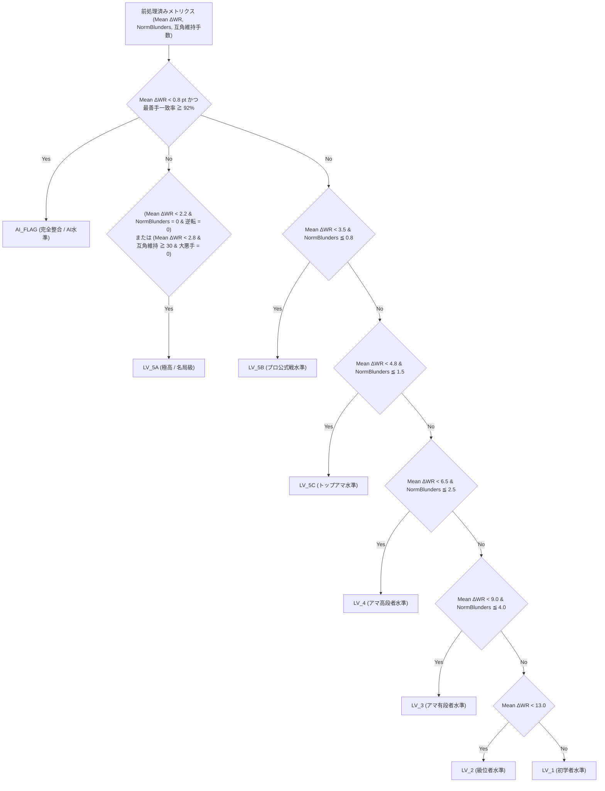

# 棋樹 (joseki-tree) - 棋譜対局評価エンジン 仕様書 v2.0 (Game Quality Evaluation & Insight Engine)

本書は、棋譜（KIF/CSA/JKF）および将棋エンジンによる局面解析データに基づき、対局の品質・指し手精度（棋力相当レベル判定）、5軸レーダーチャートスコア、および一口講評（サマリーコメント）をクライアント完結・決定論的（高速・追加LLM不要）に自動生成する「棋譜対局評価エンジン（v2.0：期待勝率落幅 $\Delta\text{WR}$ 基準）」の正式仕様書である。

---

## 1. 機能概要と v2.0 改訂の目的

### 1.1 目的
- 単なる平均損失（ACL: Average Centipawn Loss）の集計にとどまらず、**「期待勝率の維持度（$\Delta\text{WR}$）」「急所局面での勝負強さ」「手数正規化された安定度」「終盤リードの維持度」**を統合した高精度な棋力レベル判定を提供する。
- 将棋ソフトの評価値（cp）が優劣拡大に伴って指数関数的にインフレする特性を考慮し、**シグモイド関数による期待勝率変換（Win Rate %）**を基盤に据えることで、「勝勢局面での安全勝ち（絶対cpは下がるが勝率は揺るがない指し手）」が不当に悪手判定される問題（勝者への二重罰）を排除する。
- WebAssemblyエンジンの浅層探索（深さ8〜12）における微小な評価値ノイズや、長手数の熱戦が構造的に不利になる回数カウント方式を是正し、プロ公式戦から級位者対局まで納得感のある**「5軸レーダーチャート（0〜100点）」**および**「2文構成の一口メモ（講評文）」**を瞬時に自動生成する。

---

## 2. システム入出力仕様

### 2.1 入力パラメータ (`MoveAnalysisInput[]`)

各手の解析データは以下の情報を持つ。

| 項目 | 型 | 説明 |
| :--- | :--- | :--- |
| `ply` | `number` | 手数（1〜N） |
| `turn` | `'b' \| 'w'` | 手番（`'b'`: 先手, `'w'`: 後手） |
| `playedMove` | `string` | 実際に指された手（USI形式、例: `7g7f`） |
| `bestMove` | `string` | エンジン推奨最善手（USI形式） |
| `bestScore` | `number` | 着手前の最善評価値（歩換算センチポーン。**先手視点**） |
| `playedScore` | `number` | 実際に指した後の評価値（**先手視点**） |
| `secondScore` | `number \| undefined` | エンジン第2候補手の評価値（存在する場合、先手視点） |
| `isBookMove` | `boolean \| undefined` | 定跡木（Book DB）に合致した手であるか |

### 2.2 出力データ (`GameEvaluationResult`)

```typescript
export interface GameEvaluationResult {
  matchId?: string;
  overallLevel: QualityLevel;
  black: PlayerInsight;
  white: PlayerInsight;
  analyzedAt: string; // ISO 8601
}
```

---

## 3. 前処理および期待勝率変換仕様

統計的な歪み（勝勢時の評価値インフレ、定跡手によるインフレ、浅層探索ノイズ）を防止するため、集計前に以下の前処理を適用する。

### 3.1 手番視点への正規化
すべての評価値は「手番側の視点（手番側有利が正）」に正規化する。
- 先手番（`b`）：$V = \text{score}$
- 後手番（`w`）：$V = -\text{score}$

### 3.2 期待勝率（Win Rate %）変換と勝率落幅（$\Delta\text{WR}$）
将棋エンジンの評価値スケール（$600\text{ cp} \approx \text{勝率 } 73.1\%$）に基づき、手番視点の評価値 $V$（cp）を期待勝率 $W(V) \in [0, 100]$（%）へ変換する。

$$W(V) = \frac{100}{1 + \exp(-V / 600)}$$

| 評価値 $V$ (cp) | 期待勝率 $W(V)$ | 形勢の目安 |
| :--- | :--- | :--- |
| $0\text{ cp}$ | $50.0\%$ | 互角 |
| $+300\text{ cp}$ | $62.2\%$ | 有利 |
| $+600\text{ cp}$ | $73.1\%$ | 優勢 |
| $+1200\text{ cp}$ | $88.1\%$ | 勝勢 |
| $+2000\text{ cp}$ | $96.6\%$ | 必勝 |

1. **浅層探索ノイズフロア（免責閾値）**:
   - 1手の評価値低下 $\Delta V = \max(0, V_{\text{before}} - V_{\text{after}})$ が **$30\text{ cp}$ 以下**（またはエンジン最善手と完全一致）の場合、探索揺らぎの範囲内とみなして $\Delta\text{WR} = 0$ とする。
2. **1手の期待勝率落幅（$\Delta\text{WR}$）**:
   $$\Delta\text{WR} = \max\bigl(0,\; W(V_{\text{before}}) - W(V_{\text{after}})\bigr)$$
   - これにより、たとえば $+1200\text{ cp} \to +850\text{ cp}$ の変化（$\Delta V = 350\text{ cp}$）は $\Delta\text{WR} = 88.1\% - 80.5\% = 7.6\text{ pt}$ となり、互角時の $-350\text{ cp}$（$\Delta\text{WR} = 50.0\% - 35.8\% = 14.2\text{ pt}$）よりも軽微な損として自然に重み付けされる（**勝者免責の自動化**）。

### 3.3 序盤定跡手の除外（Book Truncation）
- **基本ルール**: 原則として**1手目〜30手目**（`ply <= 30`）、または事前登録定跡木（Book DB）に完全一致している区間（`isBookMove === true`）は、中終盤の有効手数（`isEffective`）から除外する。
- **レーダーチャート「序盤力」特例**: 序盤力（`opening`）スコア算出のみ、この1〜35手目区間を対象としてベイズ平滑化付きで個別集計する（第4.2項参照）。

### 3.4 大差局面の除外と損失キャップ（Cap & Clamp）
1. **大差局面除外**:
   - 着手前の手番側評価値が **$\lvert V_{\text{before}} \rvert > 2,000\text{ cp}$（勝率 $96.6\%$ 超または $3.4\%$ 未満）** の状態での指し手は、大勢が決しているため有効手数から除外する。
   - **例外**: 着手前に $+2,000\text{ cp}$ 超であったにもかかわらず、1手で $+600\text{ cp}$ 未満へ急落させる大頓死（$\Delta\text{WR} \ge 20\text{ pt}$）を指した場合は、除外せず有効手（大悪手）としてカウントする。
2. **cp損失キャップ処理（参考指標 ACL 用）**:
   - 従来の平均損失（ACL）も参考指標として併記するため、$\Delta V_{\text{capped}} = \min(500, \Delta V)$ により最大 $500\text{ cp}$ にクリップする。

---

## 4. 詳細算出ロジック

### 4.1 基礎メトリクス定義
有効手数集合を $M$（要素数 $|M|$、最小分母補正用基準手数を $30$ 手）とする。

1. **平均勝率損失（Mean Win-Rate Loss: `meanWinRateLoss`）**:
   $$\text{Mean }\Delta\text{WR} = \frac{1}{|M|} \sum_{m \in M} \Delta\text{WR}(m)$$
2. **補正後平均cp損失（ACL: Average Centipawn Loss）**:
   $$\text{ACL} = \frac{1}{|M|} \sum_{m \in M} \Delta V_{\text{capped}}(m)$$
3. **悪手・緩手カウント（$\Delta\text{WR}$ 基準）**:
   - **大悪手（Blunder）**: $\Delta\text{WR} \ge 20.0\text{ pt}$（互角付近での約 $-500\text{ cp}$ 相当以上の転落）
   - **中悪手（Mistake）**: $10.0\text{ pt} \le \Delta\text{WR} < 20.0\text{ pt}$（互角付近での約 $-240 \sim -499\text{ cp}$ 相当の損失）
   - **微小緩手（Inaccuracy）**: $5.0\text{ pt} \le \Delta\text{WR} < 10.0\text{ pt}$（互角付近での約 $-120 \sim -239\text{ cp}$ 相当の微損）
4. **手数正規化レート（Normalized Rates per 30 Effective Moves）**:
   - 長手数の熱戦が回数累積によって不利にならないよう、有効手数30手（1局の標準的な中終盤手数）あたりの発生回数に正規化する。
   $$\text{NormFactor} = \frac{30}{\max(15, |M|)}$$
   $$\text{NormBlunders} = \text{blunderCount} \times \text{NormFactor}, \quad \text{NormMistakes} = \text{mistakeCount} \times \text{NormFactor}$$
5. **急所局面正解率（Critical Accuracy）**:
   - **急所局面の定義（ハイブリッド判定）**:
     - `secondScore` が提供されている場合: $W(V_{\text{best}}) - W(V_{\text{second}}) \ge 12.0\text{ pt}$（または $V_{\text{best}} - V_{\text{second}} \ge 150\text{ cp}$）。
     - `secondScore` が未提供（単一PV解析）の場合: 着手前の期待勝率が **$25\% \le W(V_{\text{before}}) \le 75\%$（評価値 $\lvert V_{\text{before}} \rvert \le 650\text{ cp}$ の緊迫した中終盤）** である有効手を急所母集団とする。
   - **正解判定**: 当該局面で $\Delta\text{WR} \le 3.0\text{ pt}$（最善手追随または好手）を指せた割合（%）。該当局面が3回未満の場合は $85\%$（標準値）として扱う。
6. **終盤逆転許容回数（Reversal Count）**:
   - 期待勝率が **$70.0\%$ 以上（約 $+500\text{ cp}$ 以上の優勢）** に到達した以降の手順において、期待勝率が **$45.0\%$ 以下（約 $-120\text{ cp}$ 以下の互角〜劣勢）** まで押し戻された回数。

---

### 4.2 5軸レーダーチャートスコア算出ロジック (0〜100点)

各軸の役割を分離し、1つのミスが全軸を同時に破壊しない設計とする。各指標は整数値（$0 \sim 100$）に丸めて出力する。

| 軸 | 指標名 | 対象区間 | 算出式（ベイズ平滑化・$\Delta\text{WR}$ 基準） | 特記事項 |
| :--- | :--- | :--- | :--- | :--- |
| ① | **序盤力**<br>(`opening`) | 1〜35手目 | $\text{SmoothLoss}_{\text{open}} = \frac{\sum_{m \in \text{Open}} \Delta\text{WR}(m)}{|\text{Open}| + 5}$<br>$\text{score} = \text{clamp}(100 - \text{SmoothLoss}_{\text{open}} \times 8.0,\; 40,\; 100)$ | 分母にダミー5手を加えるベイズ平滑化により、序盤1手のブレで0点に崩壊する現象を防止。定跡20手以上一致で最低85点保証。 |
| ② | **中盤力**<br>(`midgame`) | 36手目以降かつ<br>$\lvert V_{\text{before}} \rvert < 600\text{ cp}$ | $\text{AvgLoss}_{\text{mid}} = \text{中盤の平均 }\Delta\text{WR}$<br>$\text{score} = \text{clamp}(100 - \text{AvgLoss}_{\text{mid}} \times 7.0 + \text{TensionBonus},\; 25,\; 100)$ | **互角維持ボーナス**: $\lvert V \rvert \le 200\text{ cp}$ が手番側25手（計50手）以上で $+8$ 点、35手（計70手）以上で $+15$ 点。 |
| ③ | **終盤力**<br>(`endgame`) | 36手目以降かつ<br>$\lvert V_{\text{before}} \rvert \ge 600\text{ cp}$ | $\text{score} = \text{clamp}(100 - (\text{Blunders}_{\text{end}} \times 25) - (\text{Mistakes}_{\text{end}} \times 10) - (\text{Reversals} \times 18),\; 20,\; 100)$ | $\Delta\text{WR}$ 化により勝勢維持のままの損は減点対象外（勝者免責）。終盤未到達時は中盤力と安定度の平均（デフォルト78点）を採用。 |
| ④ | **安定度**<br>(`stability`) | 対局全区間（有効手数） | $\text{score} = \text{clamp}(100 - (\text{NormBlunders} \times 22) - (\text{NormMistakes} \times 8),\; 15,\; 100)$ | 30手あたり正規化レートを使用するため、150手超の長手数対局でも不当に減点されない。 |
| ⑤ | **勝負強さ**<br>(`tactics`) | 急所局面（勝率 $25\sim 75\%$）＆劣勢局面 | $\text{score} = \text{clamp}((\text{CriticalAccuracy} \times 0.85) + \text{TenacityBonus},\; 25,\; 100)$ | `secondScore` なしでも実数値で稼働。劣勢（$\le -500\text{ cp}$）で10手以上抵抗で $+8$ 点、20手以上抵抗で $+15$ 点。 |

---

### 4.3 棋力レベル判定マッピング基準（手数正規化・$\Delta\text{WR}$ 較正版）

判定は最上位レベルから順に評価し、条件を満たした最初のランクを割り当てる。



| レベル識別子 | 表示名 | 判定条件（$\Delta\text{WR}$ ＆ 正規化レート基準） | 位置づけ |
| :--- | :--- | :--- | :--- |
| `AI_FLAG` | 検知: 完全整合 | $\text{Mean }\Delta\text{WR} < 0.8\text{ pt}$ かつ 92%以上が最善手一致 | 人間離れした一致度。ソフト指しまたは長手数完全定跡。 |
| `LV_5A` | **極高（名局級）** | $\text{Mean }\Delta\text{WR} < 2.2\text{ pt}$, $\text{NormBlunders} = 0$, $\text{Reversals} = 0$<br>（または $\text{Mean }\Delta\text{WR} < 2.8\text{ pt}$ かつ 互角維持 $\ge 30$手 かつ 大悪手 $0$） | タイトル戦・順位戦上位クラスの会心譜。緊迫した均衡が保たれた名局。 |
| `LV_5B` | **プロ公式戦水準** | $\text{Mean }\Delta\text{WR} < 3.5\text{ pt}$ かつ $\text{NormBlunders} \le 0.8$ | プロ公式戦の標準的対局、奨励会三段・トップアマ好局。 |
| `LV_5C` | **トップアマ水準** | $\text{Mean }\Delta\text{WR} < 4.8\text{ pt}$ かつ $\text{NormBlunders} \le 1.5$ | 全国大会クラスの力戦。中盤に微細な損があるが大崩れしない。 |
| `LV_4` | **アマ高段者水準** | $\text{Mean }\Delta\text{WR} < 6.5\text{ pt}$ かつ $\text{NormBlunders} \le 2.5$ | 県代表〜三段・四段クラス。致命傷は少ないが中悪手が混じる。 |
| `LV_3` | **アマ有段者水準** | $\text{Mean }\Delta\text{WR} < 9.0\text{ pt}$ かつ $\text{NormBlunders} \le 4.0$ | 初段・二段クラス。中終盤で形勢の波が複数回生じる。 |
| `LV_2` | **級位者水準** | $\text{Mean }\Delta\text{WR} < 13.0\text{ pt}$ | 駒のタダ取りや自爆など、急激な勝率転落が複数回発生。 |
| `LV_1` | **初学者水準** | $\text{Mean }\Delta\text{WR} \ge 13.0\text{ pt}$ | 王手見落とし、囲い崩壊など重大なミスが継続。 |

#### 対局総合レベル（`overallLevel`）とUI併記ルール
- **算出式**: 片方のプレイヤーが終盤に頓死しただけで対局全体が「級位者水準」に引きずり下ろされる現象を防ぐため、`min(black, white)` ではなく**勝者側に重み（60%）を置いた加重平均ランク**（勝敗不明時は単純平均の四捨五入）を採用する。
  $$\text{OverallRank} = \text{round}\bigl(0.6 \times \text{Rank}_{\text{winner}} + 0.4 \times \text{Rank}_{\text{loser}}\bigr)$$
- **UI表示ルール**: モーダルヘッダー等では `overallLevel` の単独表示とせず、必ず **`[全体: プロ公式戦水準] (▲先手: 名局級 / △後手: アマ高段者水準)`** のように先手・後手の個別レベルバッジを併記する。

---

### 4.4 一口メモ（講評テキスト）自動生成仕様

外部LLM APIへの通信遅延やコストを発生させず、決定論的かつ高速に自然な講評文を組み立てるため、「展開パターン判定（前半）＋ 特徴量ハイライト（後半）」の2文構成テンプレート方式を採用する。

#### 4.4.1 展開パターン判定マトリクス（前半文）

| 優先順 | パターン識別子 | 判定条件 | 出力テキスト（勝者） | 出力テキスト（敗者） |
| :---: | :--- | :--- | :--- | :--- |
| **特例** | （長手数互角名局） | `evenPliesCount >= 30`<br>（全体で60手以上が $\pm 200\text{ cp}$ 以内） | 「深い構想がぶつかり合い、`{evenPliesCount * 2}`手にわたって緊迫した互角が維持された名局を制しました。」 | 「双方の構想が拮抗し、`{evenPliesCount * 2}`手にわたり張り詰めた互角が続いた素晴らしい激戦でした。」 |
| **1** | `CRUSH`<br>（急戦即死・大破） | 60手未満で $\Delta\text{WR} \ge 25\text{ pt}$ の大悪手による決着 | 「相手の踏み込みの乱れを鋭くとがめ、一気の急襲で勝勢を確立しました。」 | 「序盤の仕掛けで致命的な見落としが生じ、一気に陣形を崩されてしまいました。」 |
| **2** | `COMEBACK`<br>（逆転勝ち / 逆転負け） | 中盤以降 $-500\text{ cp}$ 以下の劣勢から $+500\text{ cp}$ 以上の優勢へ逆転 | 「中盤の劣勢を粘り強い指し回しで耐え凌ぎ、終盤の好機を捉えて見事に逆転しました。」 | 「中盤まで優勢に進めていましたが、終盤の寄せ合いで痛恨の緩手が出て逆転を許しました。」 |
| **3** | `SEESAW`<br>（混戦・大熱戦） | 優劣が2回以上入れ替わる（評価値ゼロクロスが複数回） | 「互いに譲らない大熱戦となり、最後の最後まで勝敗の行方が分からない激戦を制しました。」 | 「激しい攻防が続いた大混戦でしたが、最終盤のわずかな差で惜しくも競り負けました。」 |
| **4** | `WIRE_TO_WIRE`<br>（完勝 / 完敗） | 30手目以降、一度も手番側評価値が $-100\text{ cp}$ を下回らずリード維持 | 「序盤から主導権を握り、相手に反撃の隙を与えず押し切った完勝譜です。」 | 「序盤の遅れを取り戻せず、相手の正確な指し回しに圧倒された一局でした。」 |

#### 4.4.2 特徴量ハイライト（後半文）

レーダーチャートのスコアから、「突出した強み」または「主たる敗因・課題」を抽出して付与する。

1. `scores.stability >= 90`:
   「対局を通じて目立った悪手やポカが一切なく、極めて精度の高い指し手が維持されています。」
2. `!isWinner && scores.endgame <= 45`:
   「勝ち筋があった局面での速度計算・自玉の安全度管理に課題が残りました。」
3. `scores.tactics >= 85`:
   「局面の分岐点となる急所での踏み込みが極めて鋭く、勝負どころを的確に制しました。」
4. `scores.midgame >= 85`:
   「中盤のねじり合いにおける構想力と、遊び駒を作らない手厚い指し回しが光りました。」
5. `scores.stability <= 50`:
   「中盤から終盤にかけて形勢を損ねる手が散見されたため、ミスの削減が今後の明確なテーマとなります。」
6. 上記以外（標準時）:
   「全体としてバランスの取れた安定した指し回しでした。」

---

## 5. TypeScriptインターフェース定義

`src/types/evaluation.ts` の型定義：

```typescript
import { Color } from './shogi';

export type QualityLevel =
  | 'AI_FLAG'
  | 'LV_5A'
  | 'LV_5B'
  | 'LV_5C'
  | 'LV_4'
  | 'LV_3'
  | 'LV_2'
  | 'LV_1';

export type MatchPattern =
  | 'WIRE_TO_WIRE'
  | 'COMEBACK'
  | 'SEESAW'
  | 'CRUSH';

export interface MoveAnalysisInput {
  ply: number;
  turn: Color;
  playedMove: string;     // USI (e.g., '7g7f')
  bestMove: string;       // USI
  bestScore: number;      // Sente POV (cp)
  playedScore: number;    // Sente POV (cp)
  secondScore?: number;   // Sente POV (cp)
  isBookMove?: boolean;
}

export interface MatchMetrics {
  effectiveMoves: number;
  acl: number;
  meanWinRateLoss?: number; // Mean ΔWR (0-100 scale)
  criticalAccuracy: number;
  blunderCount: number;
  mistakeCount: number;
  inaccuracyCount: number;
  reversalCount: number;
  evenPliesCount: number;
  evenTensionRate: number;
}

export interface RadarChartScores {
  opening: number;    // 序盤力 (0-100)
  midgame: number;    // 中盤力 (0-100)
  endgame: number;    // 終盤力 (0-100)
  stability: number;  // 安定度 (0-100)
  tactics: number;    // 勝負強さ・急所 (0-100)
}

export interface PlayerInsight {
  color: Color;
  level: QualityLevel;
  isWinner: boolean;
  metrics: MatchMetrics;
  radarChart: RadarChartScores;
  pattern: MatchPattern;
  summaryComment: string;
}

export interface GameEvaluationResult {
  matchId?: string;
  overallLevel: QualityLevel;
  black: PlayerInsight;
  white: PlayerInsight;
  analyzedAt: string; // ISO 8601
}
```
