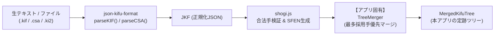
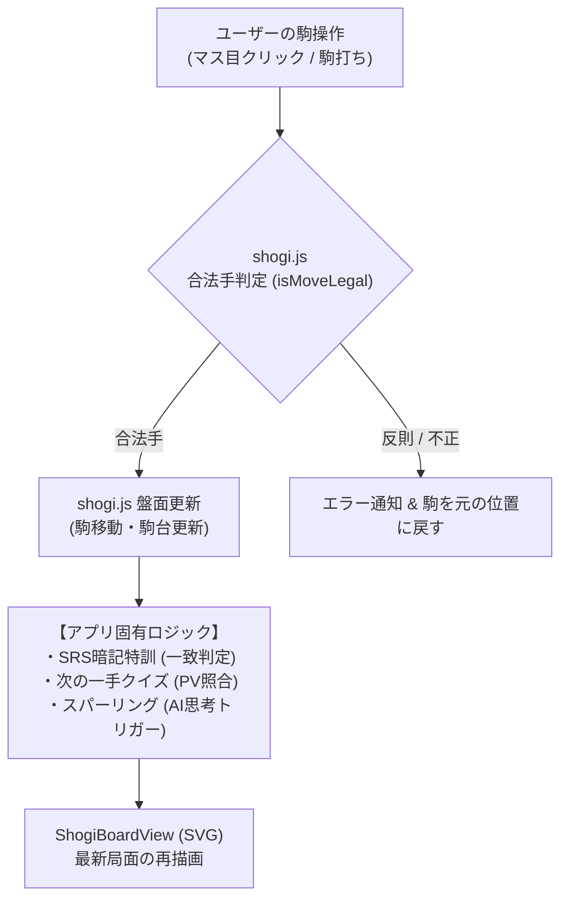

# 棋樹 (joseki-tree) - リメイク設計仕様書：汎用将棋ライブラリ主軸アーキテクチャ (Core Architecture & Generic Library Adoption Spec)

本書は、将棋アプリ（棋樹: joseki-tree）を抜本的にリメイク・再構築するにあたり、**「棋譜パーサー・棋譜表現・盤面状態・ルール判定（反則手検知）は実績ある汎用ライブラリを全面的に主軸とし、自前実装は本アプリ固有の付加価値機能（定跡ツリー合成・SRS・クイズ抽出・評価エンジン等）に特化する」**という設計方針に基づく正式な技術選定・移行仕様を定義する。

現時点の自前パーサー（`kifParser.ts`）や自前ルール判定（`shogiRules.ts`, `shogiBoard.ts`）への後方互換性やコードの延命には固執せず、標準エコシステムの上に再構築する。

---

## 1. 基本方針と責務分離 (Separation of Concerns)

```
┌─────────────────────────────────────────────────────────────────────────┐
│               【アプリ固有の付加価値レイヤー】(自前実装・TypeScript)                │
│  ・最多採用手ツリー合成 (Tree Merger)     ・SRS暗記特訓 (SM-2 Scheduler)     │
│  ・次の一手クイズ抽出エンジン (Quiz Extractor) ・5軸対局評価エンジン (Quality Eval) │
└────────────────────────────────────┬────────────────────────────────────┘
                                     │ 呼び出し / 拡張
┌────────────────────────────────────▼────────────────────────────────────┐
│               【将棋ドメイン標準基盤レイヤー】(汎用ライブラリ主軸)                 │
│  ・棋譜入出力・相互変換 (KIF / CSA / KI2 / SFEN) -> json-kifu-format (JKF)│
│  ・盤面状態管理・合法手判定・反則手検知 (二歩/打歩詰/千日手) -> shogi.js      │
│  ・UIアセット (本榧木目盤 & 柘植駒ベクタースプライト)   -> board.svg / piece.svg │
│  ・AI検討・対局エンジン (Wasm Web Worker)        -> Fairy-Stockfish/やねうら王│
│  ・PWA完全オフライン化 (Wasm/評価関数キャッシュ)    -> vite-plugin-pwa        │
└─────────────────────────────────────────────────────────────────────────┘
```

### 1.1 汎用ライブラリを主軸とする理由
1. **表記揺れ・フォーマット乱立の根絶**:
   - 柿木形式の「同　銀」、空白区切り、Shift-JIS/UTF-8エンコード、CSA形式（将棋ウォーズ標準）、KI2形式、Web用JKFなどを自前パーサーで網羅・保守し続けるのはコストが膨大。`json-kifu-format` を通すことで、一瞬で正規化されたJSON構造が得られる。
2. **ルール判定の厳密性とバグ排除**:
   - 自前実装では「王手放置」「二歩」までは対応できても、「打ち歩詰め」「連続王手の千日手」「最大手数」「入玉宣言法」などのエッジケースで不具合が発生しやすい。`shogi.js` を主軸とすることで、反則手判定の信頼性を100%保証できる。
3. **開発リソースを差別化機能へ集中**:
   - 車輪の再発明（ルールとパーサー）をやめ、本アプリの核である「定跡ツリー合成」「SRS暗記特訓」「次の一手クイズ」「AIスパーリング」「5軸レーダー評価」にリソースを集中投下する。

---

## 2. 採用ライブラリと役割定義

| 領域 | 採用ライブラリ | 役割と責務 |
| :--- | :--- | :--- |
| **棋譜パース・相互変換** | **`json-kifu-format` (JKF)**<br>(+ `kakinoki-kifu-parser`) | ・`.kif`, `.csa`, `.ki2`, `.jkf` のインポートと相互変換。<br>・文字コード自動処理（UTF-8, Shift-JIS）。<br>・対局メタデータ（対局者、日付、戦型、勝敗）の抽出。 |
| **盤面・ルールエンジン** | **`shogi.js` (na2hiro)** | ・盤面オブジェクト（手番、駒配置、駒台）。<br>・合法手の全列挙（`getMoves()`）、反則手判定（二歩、打ち歩詰め、千日手）。<br>・指し手実行（`move()`）と局面更新、SFEN出力。 |
| **盤面・駒UI描画** | **SVGスプライトコンポーネント**<br>(`board.svg` + `piece_wood.svg`) | ・本榧木目テクスチャと縦長マス目による最高峰の盤面描画。<br>・32駒のベクタースプライト（`<use href="#piece-X" />`）によるシャープな描画。<br>・フォント非依存、完全レスポンシブ。 |
| **AI Sparring & 分析** | **Web Worker Wasm USI Bridge**<br>(Fairy-Stockfish / TuyouraOu) | ・ブラウザ内Wasm実行によるサーバーレス評価値算出と次の一手生成。 |
| **PWA & オフライン** | **`vite-plugin-pwa` (Workbox)** | ・Wasmバイナリおよび評価関数ファイル（約8MB）のCacheStorage永続化。<br>・通信圏外（飛行機・地下鉄）での完全動作。 |

---

## 3. リメイク後のデータフロー仕様

### 3.1 棋譜取り込みから定跡ツリー合成までの流れ
従来の自前パース方式を完全に廃止し、JKFを起点とするクリーンなパイプラインに置き換える。



1. **パース**: 入力形式を問わず `json-kifu-format` を呼び出し、一律でJKF形式のJSONオブジェクトへ変換。
2. **ルール検証**: JKFの指し手リストを `shogi.js` に順次流し込み、反則手のない正規局面であることを確認しつつ、各手の盤面SFENを取得。
3. **ツリー合成**: JKFの分岐構造から、本アプリ固有の「最多採用手を本譜とするマージアルゴリズム（`TreeMerger`）」により `MergedKifuTree` を構築。

---

### 3.2 盤面操作・対局・特訓時のデータフロー
ユーザーのドラッグ/クリックによる指し手検証はすべて `shogi.js` が担う。



---

## 4. 自前実装として残す領域（アプリ固有のコア価値）

以下のドメイン機能は汎用将棋ライブラリには存在しないため、本アプリのオリジナルコードとして洗練させて実装する。

1. **定跡ツリー合成エンジン (`treeMerger.ts`)**:
   - 複数棋譜の同一局面を統合し、最多採用手を自動でメインラインに設定するアルゴリズム。
   - 分岐コメントや過去対局参照リスト（`gameRefs`）の集約。
2. **SRS記憶定着アルゴリズム (`srsScheduler.ts`)**:
   - SM-2アルゴリズムに基づく忘却曲線スケジューリング（間隔・復習日・イーズ係数）。
   - 5種類の手がかりヒント判定（段・筋・駒種・盤上/持駒・正解表示）。
3. **次の一手クイズ自動抽出エンジン (`quizExtractor.ts`)**:
   - 評価値の急変（逆転・好機・絶対の受け・寄せ）から3〜5手の戦術課題局面を抽出するロジック。
4. **棋譜対局評価エンジン (`gameEvaluation.ts`)**:
   - 前処理（定跡除外・大差クリップ）、手番別ACL、大悪手/緩手分類、急所局面正解率。
   - 5軸レーダーチャート（0〜100点）および展開パターン×特徴量の講評テキスト自動生成。

---

## 5. 推奨パッケージ導入とリメイク移行手順

### 5.1 導入パッケージ
```bash
npm install shogi.js json-kifu-format
npm install -D vite-plugin-pwa workbox-window
```

### 5.2 移行ロードマップ
- **Phase 1: 基盤ライブラリ導入 & 盤面操作の `shogi.js` 置き換え**
  - `src/utils/shogiRules.ts` および `shogiBoard.ts` の自前判定を `shogi.js` の `Shogi` クラスへリプレイス。
  - 合法手・駒打ち・反則手判定を `shogi.js` に全面委譲。
- **Phase 2: 棋譜パーサーの JKF 置き換え**
  - `src/utils/kifParser.ts` を `json-kifu-format` を使った統一インポーターへ刷新。
  - `.kif` に加え `.csa` / `.ki2` / `.jkf` の取り込みを正式サポート。
- **Phase 3: SVG盤面・駒スプライトの完全統合 (Issue #11c)**
  - `board.svg` および `piece_wood.svg` を `ShogiBoardView` に完全適用。
- **Phase 4: PWAオフライン化 (Issue #23)**
  - `vite-plugin-pwa` を設定し、Wasmおよび評価関数をキャッシュ。
