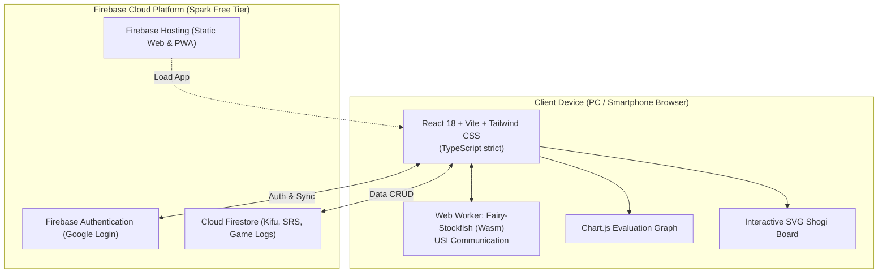

# 棋樹 (joseki-tree) - Requirements Document (要件定義書)

## 1. Project Overview (プロジェクト概要)
**棋樹 (joseki-tree)** is a web-based Shogi training and opening (定跡) study platform. It allows users to collect professional Shogi game records (KIF), merge them into a multi-branch tree, visualize them with an interactive board viewer and evaluation graph, and master the openings through Spaced Repetition (SRS) memorization drills and seamless AI sparring.

### 1.1 Core Value Proposition (提供価値)
1. **Effortless Opening Tree Creation**: Paste multiple KIF records from Shogi DB websites; the system automatically parses, categorizes, and merges them into a clean multi-branch KIF tree.
2. **Cost-Free & Multi-Device Access**: Completely operable within Firebase Spark (Free Tier) with in-browser WebAssembly (Wasm) Shogi engine—no expensive backend or server upkeep.
3. **Active Recall Training (SRS Drill)**: Memorize opening lines through spaced repetition with user-selected 5-type selective hints and blunder tracking.
4. **Seamless AI Sparring & Self-Growing Repertoire**: Play out openings against the tree; as soon as a novelty or off-book move occurs, the Wasm AI engine takes over seamlessly. Finished game lines can be fed back into the merged repertoire tree as new branches.

---

## 2. Target Users & Use Cases (想定ユースケース)
- **Primary Persona**: Serious Shogi learners and amateur players looking to build, master, and test their opening repertoires (e.g., Kakugawari, Aigakari, Yagura, R振り飛車).
- **Core Scenarios**:
  - **Scenario A (Collection & Merge)**: Quickly copy 10-20 KIF records of a specific opening from Shogi DB, paste them into the app, categorize them, and generate a unified multi-branch KIF.
  - **Scenario B (SRS Memorization Drill)**: Select Sente or Gote and practice key opening variations. Choose specific hints when stuck, review today's due positions dictated by the forgetting curve algorithm (SM-2).
  - **Scenario C (Mid-Game Sparring from Key Positions)**: Jump to move 50 on the evaluation graph, take the advantageous side, and practice converting the game against the AI.
  - **Scenario D (External Tool Integration)**: Download the merged KIF or copy it to the clipboard to feed into external tools like KifuMaster or ShogiGUI.

---

## 3. System Architecture & Tech Stack (システム構成)

### 3.1 Technology Stack Details
- **Frontend**: React 18, Vite, TypeScript (Strict mode), Tailwind CSS.
- **State & Router**: Lightweight state management (Zustand or React Context), React Router.
- **Localization (i18n)**: All UI strings externalized to `src/locales/ja.json` (and `en.json`). Source code and comments strictly in English.
- **Shogi Engine**: Fairy-Stockfish (Wasm/NNUE) running inside a browser Web Worker (Zero server cost).
- **Charts**: Chart.js for interactive evaluation graph.
- **Cloud Infrastructure**: Google Firebase (Spark Free Plan):
  - Firebase Hosting (Web distribution, PWA support).
  - Cloud Firestore (Documents: games, merged trees, SRS cards, match logs).
  - Firebase Authentication (Google single-sign-on restricted to owner).
- **CI/CD & Source Control**: GitHub, GitHub Actions (`FirebaseExtended/action-hosting-deploy`).

---

## 4. Non-Functional Requirements (非機能要件)
1. **Cost**: Must operate 100% within Firebase Spark Free Plan limits:
   - Firestore Writes < 20,000/day.
   - Firestore Reads < 50,000/day.
   - Storage < 1 GB.
2. **Performance**:
   - KIF parsing and tree merging under 1 second for 50 games.
   - Responsive UI on mobile devices (touch-friendly board and buttons).
3. **Data Integrity & Security**:
   - Firestore security rules restrict read/write access to the authenticated user's own `userId`.
   - Automatic duplicate detection for pasted KIF records.
4. **Code Quality**:
   - Zero TypeScript errors (`tsc --noEmit` must pass cleanly).
   - Strict `noImplicitAny` and strict null checks.
